SCB Collections and Recovery. Henka Group, 22 November 2026.
(C) Siam Commercial Bank and Henka Pte Ltd

# Recovery Workbench Entity Relationship Diagram v6

| Item | Value |
|---|---|
| Version | 6 |
| Date | 22 November 2026 |
| Change log | 6, 22 November 2026, D-RCV-60 microservice realignment, T3 Code / OpenCode / DeepSeek v4.1 Flash |
| Source | `06 Data/Recovery Workbench Entity Relationship Diagram v5.pdf` (read only, 16 November 2026, version 5, 97 pages). The source is a PDF, so this version is Markdown with Mermaid diagrams; no PDF is written. |
| Decision | D-RCV-60 microservice realignment |
| Tool | T3 Code / OpenCode / DeepSeek v4.1 Flash |
| Objects | 123: 89 Workbench tables, 4 extension tables and 30 ACE source views (unchanged from v5) |
| References | 108 in v5: 90 foreign keys and 18 business-key links; 54 cross a data product boundary and 54 stay inside one (unchanged from v5) |

## 1. What changed and what did not

v5 drew one `recovery` schema. Architecture v5 gives each of the 19 services its own `rwb_<name>` schema and login inside the same ACE database, so this version draws the same 123 objects grouped by owner service. The objects, keys, references, cardinalities, data products and the ACE boundary are exactly those of v5. What changes is the grouping and the treatment of a reference that crosses an owner boundary.

The source was a PDF. It cannot be edited by the office helper and no PDF is written; this Markdown file is the v6 deliverable. Every number in v5 is repeated here so the two can be read side by side.

## 2. Reference reconciliation

| Measure | Count | Note |
|---|---|---|
| References in ERD v5 | 108 | 90 foreign keys and 18 business-key links |
| Foreign keys in ERD v5 | 90 | drawn as `(FK)` inside the recovery schema |
| ACE business-key links | 18 | 14 replace a source copy; 4 join an extension table to its ACE view |
| Foreign keys kept in v6 | 44 | 42 from v5 plus the 2 metadata-registry keys that v6 adds |
| Foreign keys cut in v6 | 48 | the two tables have different owners in the Ownership Map |
| Foreign keys in Physical Schema v6 | 92 | 90 from v5 plus `sys_fields.object_name` and `sys_objects.data_product` |

The two metadata-registry keys are in Physical Schema v6 but not in ERD v5 (GAP-0115; ASM-0186). They are kept inside P1.

## 3. Data products (from ERD v5)

| Group | Data product | Objects | Tables | Extension | Views | System of record |
|---|---|---|---|---|---|---|
| DP01 | Account and arrears | 5 | 0 | 1 | 4 | ACE (ingested from ALS) |
| DP02 | Customer and party | 6 | 0 | 2 | 4 | ACE (ingested from SCBPDM and the core bank) |
| DP03 | Case and ownership | 12 | 12 | 0 | 0 | Recovery Workbench |
| DP04 | Treatment and offers | 6 | 4 | 0 | 2 | Recovery Workbench for the treatment; ACE (ingested from the core bank) for the restructure plan |
| DP05 | Contact and promises | 3 | 1 | 0 | 2 | ACE (ingested from EFS) |
| DP06 | Collateral and assets | 9 | 2 | 1 | 6 | ACE (ingested from CCMS, SVAF, AMIS and RPS) |
| DP07 | Legal events and cases | 6 | 3 | 0 | 3 | ACE (ingested from LIT and WIN) for the court record and the proof of delivery; Workbench for notices and enforcement |
| DP08 | Partner performance | 2 | 2 | 0 | 0 | Recovery Workbench |
| DP09 | Debt sale | 2 | 2 | 0 | 0 | Recovery Workbench |
| DP10 | Documents and extracted fields | 9 | 8 | 0 | 1 | Recovery Workbench document hub |
| DP11 | Scores and route economics | 1 | 0 | 0 | 1 | ACE (ingested from COLLINS) |
| DP12 | Decision log | 2 | 2 | 0 | 0 | Recovery Workbench |
| DP13 | Money and closure | 3 | 2 | 0 | 1 | ACE (ingested from ALS and GL) |
| DP14 | Reference data | 32 | 27 | 0 | 5 | Recovery Workbench |
| OPS | Loads and operations | 14 | 13 | 0 | 1 | Recovery Workbench; ACE for the batch record |
| AGT | Agent runtime | 8 | 8 | 0 | 0 | Recovery Workbench |
| RPT | Reporting | 3 | 3 | 0 | 0 | Recovery Workbench |

The 14 data products hold 98 objects; OPS, AGT and RPT hold the other 25 (123 in total).

### 3.1 ACE source views (30)

| Tier | Flyway | Views |
|---|---|---|
| Tier 1 | V0002 | `v_ace_account`, `v_ace_payment`, `v_ace_customer`, `v_ace_contact`, `v_ace_ca_relation`, `v_ace_aa_relation`, `v_ace_collateral`, `v_ace_asset`, `v_ace_efs_action`, `v_ace_efs_action_code`, `v_ace_efs_assignment`, `v_ace_bucket_log`, `v_ace_product`, `v_ace_branch`, `v_ace_holiday`, `v_ace_plan` |
| Tier 2 | V0003 | `v_ace_batch_status`, `v_ace_valuation`, `v_ace_collateral_detail`, `v_ace_npa_asset`, `v_ace_npa_sale`, `v_ace_lawsuit`, `v_ace_hearing`, `v_ace_pod`, `v_ace_write_off`, `v_ace_score`, `v_ace_party_product`, `v_ace_credit_decision`, `v_ace_esign`, `v_ace_iam_group` |

### 3.2 Extension tables (4)

`party_ext`, `contact_point_ext`, `account_ext` and `valuation_ext`, each 1:1 with an ACE record and keyed by the ACE business key `(BK)`.

## 4. Service groups

One diagram per service. An entity block carries its primary key and its local foreign keys; a cut reference is not drawn as a line and appears in section 5 instead. The four platform library objects are drawn once, in section 7, because they exist in every schema.

### 4.1 rwb-source-data (P1, wave 1, schema `rwb_source_data`)

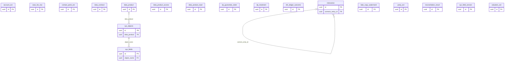

### 4.2 rwb-integration (P2, wave 1, schema `rwb_integration`)

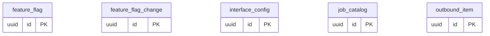

### 4.3 rwb-case (P3, wave 1, schema `rwb_case`)

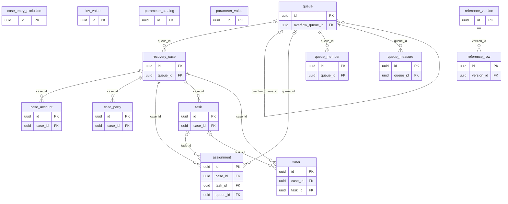

### 4.4 rwb-access (P4, wave 1, schema `rwb_access`)

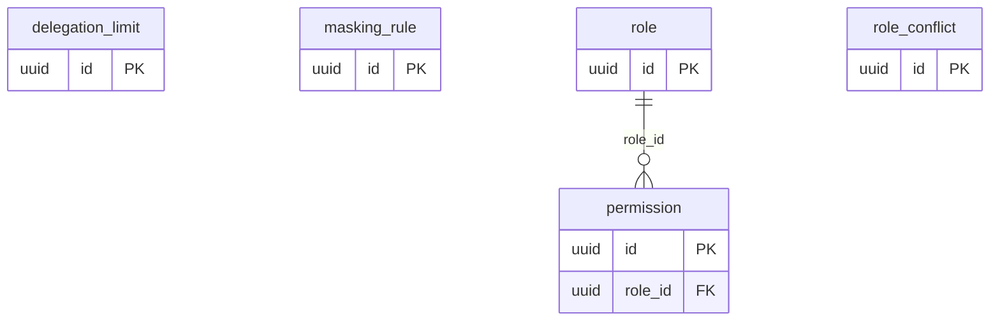

### 4.5 rwb-document (P5, wave 1, schema `rwb_document`)

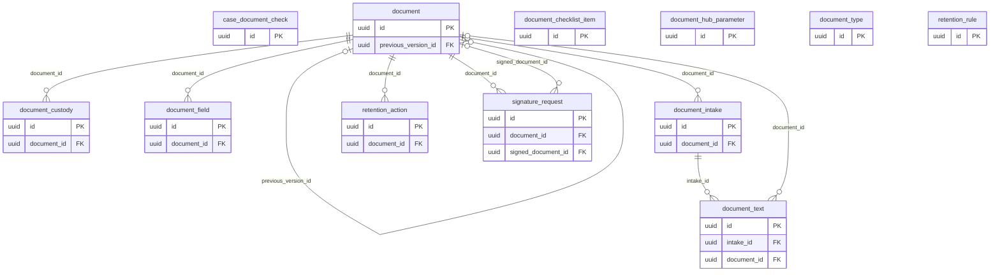

### 4.6 rwb-comms (P6, wave 1, schema `rwb_comms`)

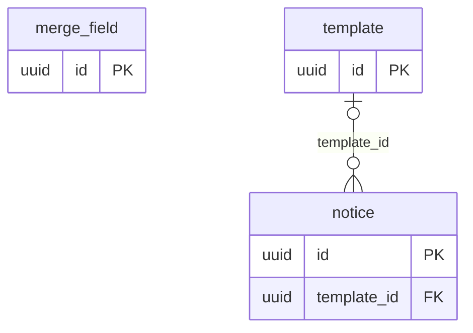

### 4.7 rwb-decision (P7, wave 1, schema `rwb_decision`)

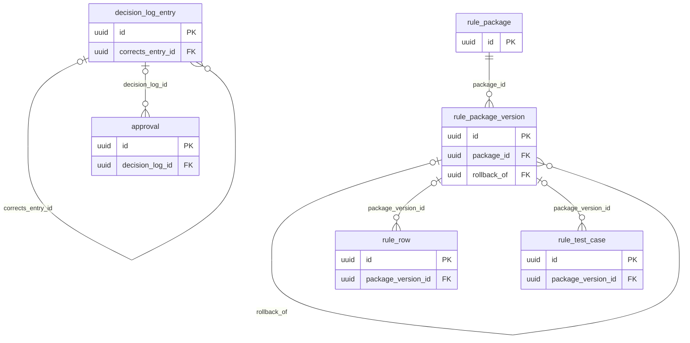

### 4.8 rwb-payment (P8, wave 2, schema `rwb_payment`)

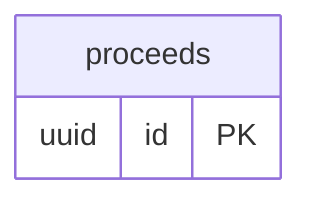

### 4.9 rwb-reporting (P9, wave 1, schema `rwb_reporting`)

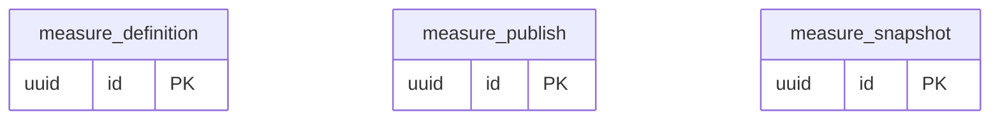

### 4.10 rwb-agent (P10, wave 1, schema `rwb_agent`)

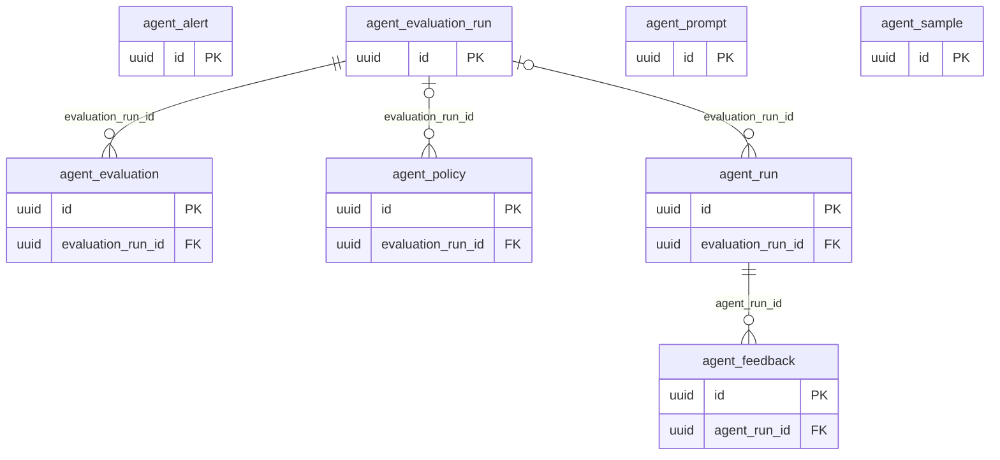

### 4.11 rwb-valuation (S1, wave 3, schema `rwb_valuation`)

rwb-valuation owns no table in the Ownership Map. It reads ACE through the rwb-source-data contract and keeps no local entity (GAP-0108; ASM-0179). The diagram is therefore empty.

```mermaid
erDiagram
    %% rwb-valuation owns no entity in the Ownership Map v1 (GAP-0108; ASM-0179)
```

### 4.12 rwb-treatment (S2, wave 2, schema `rwb_treatment`)

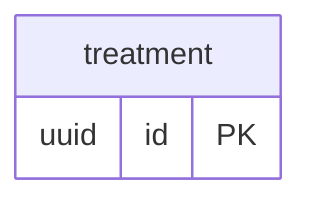

### 4.13 rwb-guarantee (S3, wave 3, schema `rwb_guarantee`)

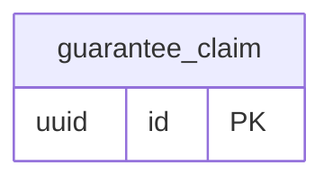

### 4.14 rwb-litigation (S4, wave 3, schema `rwb_litigation`)

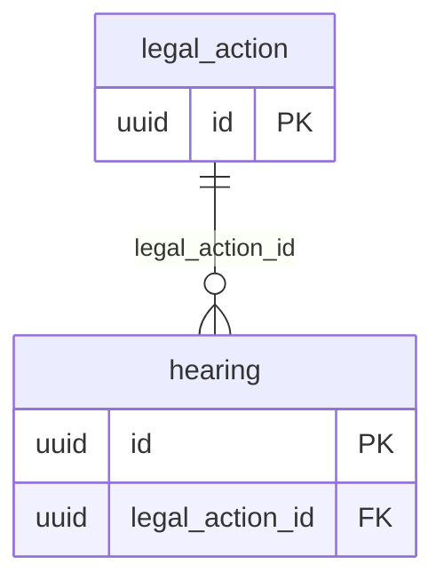

### 4.15 rwb-asset (S5, wave 2, schema `rwb_asset`)

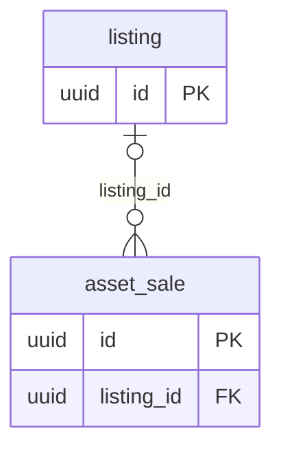

### 4.16 rwb-debtsale (S6, wave 3, schema `rwb_debtsale`)

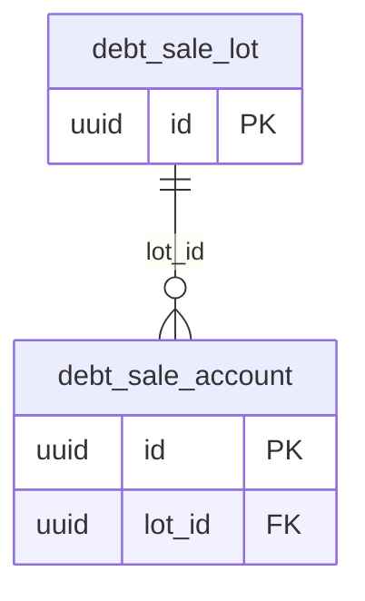

### 4.17 rwb-writeoff (S7, wave 4, schema `rwb_writeoff`)

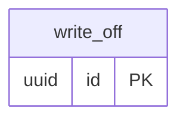

### 4.18 rwb-deviation (S8, wave 2, schema `rwb_deviation`)

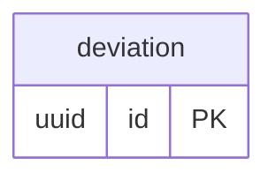

### 4.19 rwb-partner (S9, wave 4, schema `rwb_partner`)

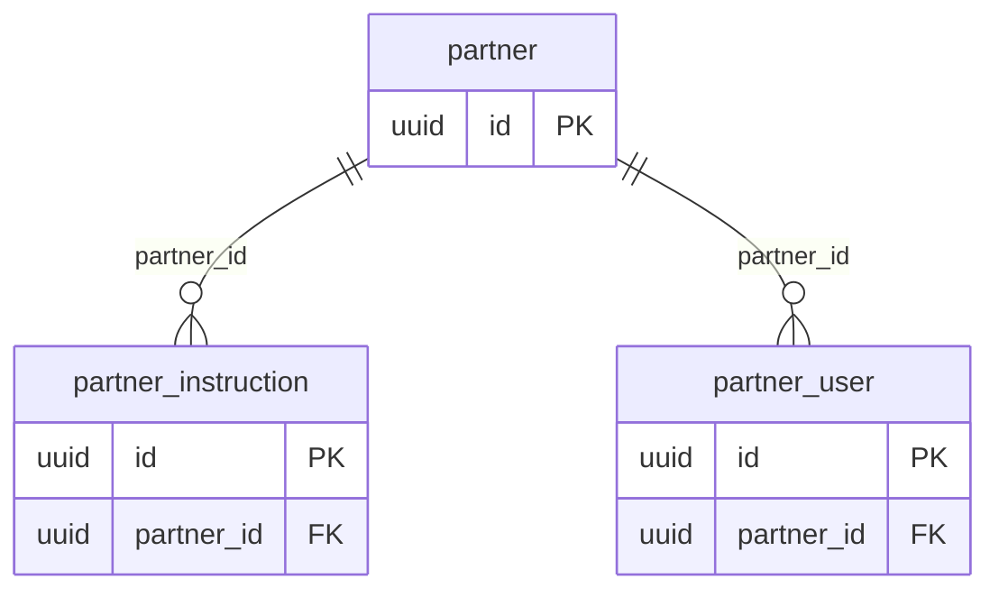

## 5. Cross-service references (cut foreign keys)

These are the 48 references whose two tables have different owners in the Ownership Map. The column stays a plain uuid and integrity is through the owner's contract (README section 5). The owning service is P1 to P10 or S1 to S9.

| # | From entity | From service | Field | To entity | To service | Reference | Becomes |
|---|---|---|---|---|---|---|---|
| 1 | `deviation` | rwb-deviation (S8) | `case_id` | `recovery_case` | rwb-case (P3) | Foreign key | plain uuid; through the rwb-case contract |
| 2 | `timer` | rwb-case (P3) | `treatment_id` | `treatment` | rwb-treatment (S2) | Foreign key | plain uuid; through the rwb-treatment contract |
| 3 | `treatment` | rwb-treatment (S2) | `case_id` | `recovery_case` | rwb-case (P3) | Foreign key | plain uuid; through the rwb-case contract |
| 4 | `treatment` | rwb-treatment (S2) | `decision_log_id` | `decision_log_entry` | rwb-decision (P7) | Foreign key | plain uuid; through the rwb-decision contract |
| 5 | `guarantee_claim` | rwb-guarantee (S3) | `case_id` | `recovery_case` | rwb-case (P3) | Foreign key | plain uuid; through the rwb-case contract |
| 6 | `legal_action` | rwb-litigation (S4) | `case_id` | `recovery_case` | rwb-case (P3) | Foreign key | plain uuid; through the rwb-case contract |
| 7 | `legal_action` | rwb-litigation (S4) | `law_firm_id` | `partner` | rwb-partner (S9) | Foreign key | plain uuid; through the rwb-partner contract |
| 8 | `notice` | rwb-comms (P6) | `case_id` | `recovery_case` | rwb-case (P3) | Foreign key | plain uuid; through the rwb-case contract |
| 9 | `notice` | rwb-comms (P6) | `document_id` | `document` | rwb-document (P5) | Foreign key | plain uuid; through the rwb-document contract |
| 10 | `notice` | rwb-comms (P6) | `dispatch_file_id` | `outbound_item` | rwb-integration (P2) | Foreign key | plain uuid; through the rwb-integration contract |
| 11 | `partner_instruction` | rwb-partner (S9) | `case_id` | `recovery_case` | rwb-case (P3) | Foreign key | plain uuid; through the rwb-case contract |
| 12 | `debt_sale_lot` | rwb-debtsale (S6) | `buyer_partner_id` | `partner` | rwb-partner (S9) | Foreign key | plain uuid; through the rwb-partner contract |
| 13 | `interaction` | rwb-source-data (P1) | `case_id` | `recovery_case` | rwb-case (P3) | Foreign key | plain uuid; through the rwb-case contract |
| 14 | `interaction` | rwb-source-data (P1) | `decision_log_id` | `decision_log_entry` | rwb-decision (P7) | Foreign key | plain uuid; through the rwb-decision contract |
| 15 | `interaction` | rwb-source-data (P1) | `treatment_id` | `treatment` | rwb-treatment (S2) | Foreign key | plain uuid; through the rwb-treatment contract |
| 16 | `interaction` | rwb-source-data (P1) | `proceeds_id` | `proceeds` | rwb-payment (P8) | Foreign key | plain uuid; through the rwb-payment contract |
| 17 | `document` | rwb-document (P5) | `case_id` | `recovery_case` | rwb-case (P3) | Foreign key | plain uuid; through the rwb-case contract |
| 18 | `document` | rwb-document (P5) | `template_id` | `template` | rwb-comms (P6) | Foreign key | plain uuid; through the rwb-comms contract |
| 19 | `document` | rwb-document (P5) | `treatment_id` | `treatment` | rwb-treatment (S2) | Foreign key | plain uuid; through the rwb-treatment contract |
| 20 | `decision_log_entry` | rwb-decision (P7) | `case_id` | `recovery_case` | rwb-case (P3) | Foreign key | plain uuid; through the rwb-case contract |
| 21 | `proceeds` | rwb-payment (P8) | `case_id` | `recovery_case` | rwb-case (P3) | Foreign key | plain uuid; through the rwb-case contract |
| 22 | `proceeds` | rwb-payment (P8) | `treatment_id` | `treatment` | rwb-treatment (S2) | Foreign key | plain uuid; through the rwb-treatment contract |
| 23 | `write_off` | rwb-writeoff (S7) | `case_id` | `recovery_case` | rwb-case (P3) | Foreign key | plain uuid; through the rwb-case contract |
| 24 | `write_off` | rwb-writeoff (S7) | `decision_log_id` | `decision_log_entry` | rwb-decision (P7) | Foreign key | plain uuid; through the rwb-decision contract |
| 25 | `case_list_row` | rwb-source-data (P1) | `case_id` | `recovery_case` | rwb-case (P3) | Foreign key | plain uuid; through the rwb-case contract |
| 26 | `retention_rule` | rwb-document (P5) | `reference_version_id` | `reference_version` | rwb-case (P3) | Foreign key | plain uuid; through the rwb-case contract |
| 27 | `dp_treatment` | rwb-source-data (P1) | `treatment_id` | `treatment` | rwb-treatment (S2) | Foreign key | plain uuid; through the rwb-treatment contract |
| 28 | `dp_treatment` | rwb-source-data (P1) | `case_id` | `recovery_case` | rwb-case (P3) | Foreign key | plain uuid; through the rwb-case contract |
| 29 | `dp_treatment` | rwb-source-data (P1) | `decision_log_id` | `decision_log_entry` | rwb-decision (P7) | Foreign key | plain uuid; through the rwb-decision contract |
| 30 | `dp_guarantee_claim` | rwb-source-data (P1) | `guarantee_claim_id` | `guarantee_claim` | rwb-guarantee (S3) | Foreign key | plain uuid; through the rwb-guarantee contract |
| 31 | `dp_guarantee_claim` | rwb-source-data (P1) | `case_id` | `recovery_case` | rwb-case (P3) | Foreign key | plain uuid; through the rwb-case contract |
| 32 | `outbox_event` | platform library (PLT) | `case_id` | `recovery_case` | rwb-case (P3) | Foreign key | plain uuid; through the rwb-case contract |
| 33 | `outbox_delivery` | platform library (PLT) | `task_id` | `task` | rwb-case (P3) | Foreign key | plain uuid; through the rwb-case contract |
| 34 | `document_type` | rwb-document (P5) | `reference_version_id` | `reference_version` | rwb-case (P3) | Foreign key | plain uuid; through the rwb-case contract |
| 35 | `document_checklist_item` | rwb-document (P5) | `reference_version_id` | `reference_version` | rwb-case (P3) | Foreign key | plain uuid; through the rwb-case contract |
| 36 | `case_document_check` | rwb-document (P5) | `case_id` | `recovery_case` | rwb-case (P3) | Foreign key | plain uuid; through the rwb-case contract |
| 37 | `case_document_check` | rwb-document (P5) | `last_event_id` | `outbox_event` | platform library (PLT) | Foreign key | plain uuid; through the platform library contract |
| 38 | `document_hub_parameter` | rwb-document (P5) | `reference_version_id` | `reference_version` | rwb-case (P3) | Foreign key | plain uuid; through the rwb-case contract |
| 39 | `document_intake` | rwb-document (P5) | `partner_id` | `partner` | rwb-partner (S9) | Foreign key | plain uuid; through the rwb-partner contract |
| 40 | `document_intake` | rwb-document (P5) | `case_id` | `recovery_case` | rwb-case (P3) | Foreign key | plain uuid; through the rwb-case contract |
| 41 | `retention_action` | rwb-document (P5) | `decision_log_id` | `decision_log_entry` | rwb-decision (P7) | Foreign key | plain uuid; through the rwb-decision contract |
| 42 | `signature_request` | rwb-document (P5) | `case_id` | `recovery_case` | rwb-case (P3) | Foreign key | plain uuid; through the rwb-case contract |
| 43 | `signature_request` | rwb-document (P5) | `treatment_id` | `treatment` | rwb-treatment (S2) | Foreign key | plain uuid; through the rwb-treatment contract |
| 44 | `approval` | rwb-decision (P7) | `case_id` | `recovery_case` | rwb-case (P3) | Foreign key | plain uuid; through the rwb-case contract |
| 45 | `approval` | rwb-decision (P7) | `delegation_limit_id` | `delegation_limit` | rwb-access (P4) | Foreign key | plain uuid; through the rwb-access contract |
| 46 | `agent_run` | rwb-agent (P10) | `case_id` | `recovery_case` | rwb-case (P3) | Foreign key | plain uuid; through the rwb-case contract |
| 47 | `agent_run` | rwb-agent (P10) | `decision_log_id` | `decision_log_entry` | rwb-decision (P7) | Foreign key | plain uuid; through the rwb-decision contract |
| 48 | `agent_feedback` | rwb-agent (P10) | `decision_log_id` | `decision_log_entry` | rwb-decision (P7) | Foreign key | plain uuid; through the rwb-decision contract |

## 6. ACE boundary and business-key links

The 30 `recovery.v_ace_*` views are external, read only, have no primary key and are never the parent of a foreign key (ERD v5 notation). The 18 business-key links below carry an ACE business key and no foreign key; they are unchanged from v5.

```mermaid
erDiagram
    v_ace_account ||--o{ account_ext : "account_key"
    v_ace_asset ||--o{ asset_sale : "asset_key"
    v_ace_account ||--o{ case_account : "account_key"
    v_ace_account ||--o{ case_entry_exclusion : "account_key"
    v_ace_account ||--o{ case_list_row : "account_key"
    v_ace_customer ||--o{ case_party : "person_key"
    v_ace_contact ||--o{ contact_point_ext : "contact_key"
    v_ace_account ||--o{ debt_sale_account : "account_key"
    v_ace_customer ||--o{ document : "person_key"
    v_ace_contact ||--o{ interaction : "contact_key"
    v_ace_customer ||--o{ interaction : "person_key"
    v_ace_asset ||--o{ listing : "asset_key"
    v_ace_customer ||--o{ notice : "person_key"
    v_ace_customer ||--o{ party_ext : "person_key"
    v_ace_payment ||--o{ proceeds : "payment_code"
    v_ace_customer ||--o{ recovery_case : "primary_person_key"
    v_ace_customer ||--o{ signature_request : "person_key"
    v_ace_valuation ||--o{ valuation_ext : "valuation_key"
```

| # | Entity | Field | Refers to | Reference | Kind |
|---|---|---|---|---|---|
| 1 | `account_ext` | `account_key` | `v_ace_account` | Mandatory | Business key, no foreign key (1:1 extension) |
| 2 | `asset_sale` | `asset_key` | `v_ace_asset` | Mandatory | Business key, no foreign key |
| 3 | `case_account` | `account_key` | `v_ace_account` | Mandatory | Business key, no foreign key |
| 4 | `case_entry_exclusion` | `account_key` | `v_ace_account` | Mandatory | Business key, no foreign key |
| 5 | `case_list_row` | `account_key` | `v_ace_account` | Mandatory | Business key, no foreign key |
| 6 | `case_party` | `person_key` | `v_ace_customer` | Mandatory | Business key, no foreign key |
| 7 | `contact_point_ext` | `contact_key` | `v_ace_contact` | Mandatory | Business key, no foreign key (1:1 extension) |
| 8 | `debt_sale_account` | `account_key` | `v_ace_account` | Mandatory | Business key, no foreign key |
| 9 | `document` | `person_key` | `v_ace_customer` | Optional | Business key, no foreign key |
| 10 | `interaction` | `contact_key` | `v_ace_contact` | Optional | Business key, no foreign key |
| 11 | `interaction` | `person_key` | `v_ace_customer` | Optional | Business key, no foreign key |
| 12 | `listing` | `asset_key` | `v_ace_asset` | Mandatory | Business key, no foreign key |
| 13 | `notice` | `person_key` | `v_ace_customer` | Optional | Business key, no foreign key |
| 14 | `party_ext` | `person_key` | `v_ace_customer` | Mandatory | Business key, no foreign key (1:1 extension) |
| 15 | `proceeds` | `payment_code` | `v_ace_payment` | Optional | Business key, no foreign key |
| 16 | `recovery_case` | `primary_person_key` | `v_ace_customer` | Mandatory | Business key, no foreign key |
| 17 | `signature_request` | `person_key` | `v_ace_customer` | Mandatory | Business key, no foreign key |
| 18 | `valuation_ext` | `valuation_key` | `v_ace_valuation` | Mandatory | Business key, no foreign key (1:1 extension) |

## 7. Platform library objects (every schema)

The four outbox, inbox and idempotency objects are owned by PLT and created in every service schema (DP-09; RWB-PLT-TE006-CON). The one key between them is local.

```mermaid
erDiagram
    outbox_event {
        uuid id PK
    }
    outbox_delivery {
        uuid id PK
        uuid event_id FK
    }
    processed_event {
        uuid id PK
        uuid event_id FK
    }
    idempotency_key {
        uuid id PK
    }
    outbox_event ||--o{ outbox_delivery : "event_id"
    outbox_event |o--o{ processed_event : "event_id"
```

## 8. Objects and keys

| Kind | Count | Key notation |
|---|---|---|
| Workbench table | 89 | square-cornered box; `(PK)`, `(AK1)`, `(FK)` as in v5 |
| Extension table | 4 | `party_ext`, `contact_point_ext`, `account_ext`, `valuation_ext`; 1:1 with an ACE record, keyed by the ACE business key `(BK)` |
| ACE source view | 30 | dashed box, read only; 16 Tier 1 (`V0002`) and 14 Tier 2 (`V0003`) |

## 9. Notation

The v5 IDEF1X notation is carried over: a square-cornered box is a Workbench table, `(PK)` is the primary key, `(AK1)` an alternate key, `(FK)` a foreign key inside the schema and `(BK)` an ACE business key with no foreign key. A dashed box is an ACE source view, external and read only. The Mermaid diagrams use `||--o{` for a mandatory parent and `|o--o{` for an optional one.

## 10. Gaps and assumptions

| ID | Gap | Assumption |
|---|---|---|
| GAP-0115 / ASM-0186 | ERD v5 draws 90 foreign keys; Physical Schema v6 has 92. | The two metadata-registry keys are added to v6 and kept inside P1; no v5 reference is dropped. |
| GAP-0107 / ASM-0178 | The Ownership Map `FK cuts` sheet is empty. | The 48 cuts are derived from sheet Tables. |
| GAP-0116 / ASM-0187 | v5 gives no owner for any object and no service grouping. | The grouping is the Ownership Map owner; the objects and references are v5 unchanged. |

## 11. Checks

- All 123 v5 objects are present: 89 Workbench tables, 4 extension tables, 30 ACE views.
- All 108 v5 references are present: 90 foreign keys (42 kept, 48 cut) and 18 business-key links.
- Every Mermaid diagram parses and every relationship uses an entity declared in the same diagram.
- No person name, e-mail address or issue-tracker reference is written.
